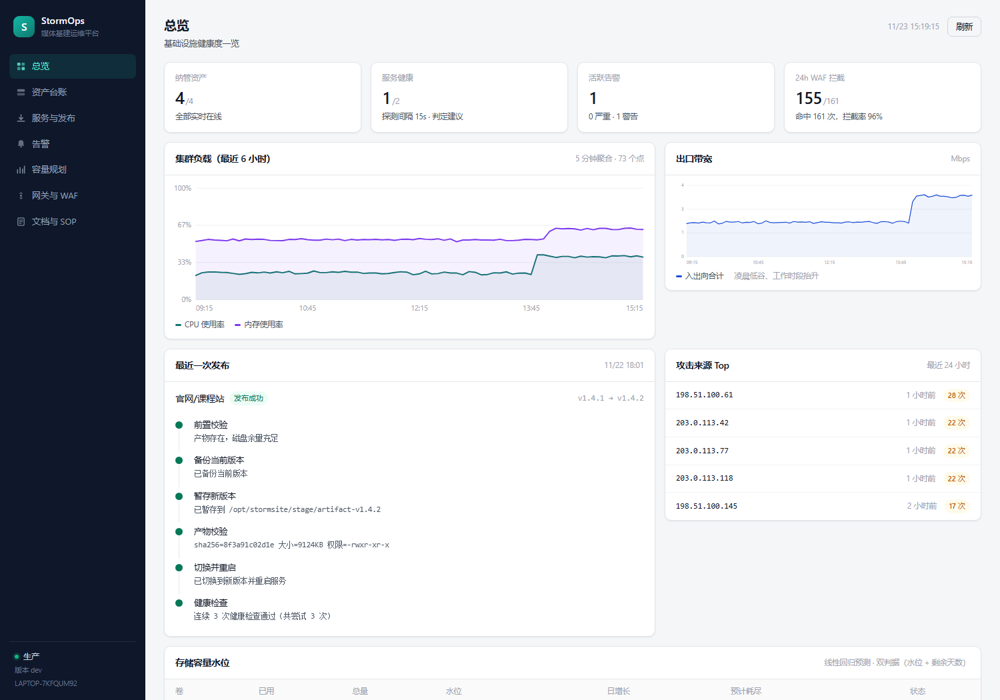

# StormOps

面向内容公司的媒体基建运维平台。一个 Go 二进制，把 CMDB、发布编排、监控告警、容量规划、Nginx 配置生成、WAF 判定收在一台 2C2G 的边缘机上。

> 这不是一个 demo 架子的 CRUD 后台。它的每条判据都在真实服务器上跑着，能被 `curl` 验证、能被 `systemctl` 观察、能被 SQL 复算。



<sub>总览页：集群负载（6 小时）、出口带宽、最近一次发布的七阶段进度、24 小时攻击来源 Top。</sub>

---

## 1. 它解决什么问题

一家做长视频的内容公司，IT 侧的真实痛点和互联网公司不一样：

| 业务现实 | 运维后果 |
| --- | --- |
| 4K 素材单条几十 GB，靠 NAS 收素材 | 存储不是"够不够用"，而是"还有几天拍不了片" |
| 导播、直播、课程、电商落地页各自独立部署 | 没有台账就没人说得清哪台机器跑着什么 |
| 官网和落地页暴露在公网，常年被扫描 | 需要 WAF，但不能因为 WAF 把自家运维锁在外面 |
| 运维就一两个人 | 平台必须能自己讲清楚"现在怎么了、为什么、下一步做什么" |

StormOps 的六个模块直接对应这六件事，不追求功能数量，追求每一块都能落到一条可执行的判据上。

---

## 2. 架构

```
                        公网 80
                           │
                    ┌──────▼───────┐
                    │    Nginx     │  ← 配置由 StormOps 生成，nginx -t 校验后 reload
                    │              │
                    │ auth_request │──────► /_waf_check ──► StormOps :8080
                    │  /ops/ 例外  │                          (内存正则，无磁盘 IO)
                    └──────┬───────┘
                           │ proxy_pass
                    ┌──────▼───────┐
                    │  stormsite   │  :8081  官网/课程站（可被发布替换）
                    └──────────────┘

  ┌────────────────────────────────────────────────────────────┐
  │  StormOps :8080        单进程，内存状态 + 3s 异步落盘        │
  │  ├── CMDB / 服务台账                                        │
  │  ├── 发布编排  precheck→backup→stage→verify→switch→health   │
  │  ├── 指标接收 + 告警判定（秒级，驱动控制台）                 │
  │  ├── 容量预测（最小二乘，输出剩余天数与 R²）                 │
  │  ├── 网关配置生成 + 校验 + 回滚                              │
  │  └── WAF 判定 + 审计                                         │
  └───────┬──────────────────────────────┬─────────────────────┘
          │ /metrics (自研，零依赖)        │ POST /internal/ingest
          ▼                              ▲
   ┌──────────────┐              ┌───────┴────────┐
   │  vmagent     │              │  stormagent    │  读 /proc、df、探测 HTTP
   │  15s 抓取    │              │  每 30s 上报   │
   └──────┬───────┘              └────────────────┘
          ▼
   ┌──────────────┐    ┌──────────┐    ┌───────────────┐
   │ VictoriaMetrics │──►│ vmalert │───►│ Alertmanager  │
   │  :8428 长期存储 │    │ :8880   │    │ :9093 分组抑制 │
   └──────────────┘    └──────────┘    └───────────────┘
          │
          │ 每日 03:20 全量导出 CSV
          ▼
   ┌──────────────┐
   │ PostgreSQL   │  趋势、排行、分位数 —— 控制台给不了的问题
   └──────────────┘
```

### 为什么是两条监控链路而不是一条

StormOps 内部有一个规则引擎，vmalert 里也有一套规则，看起来重复，实际分工不同：

- **内部引擎**：数据在内存里，判定延迟 < 1s，直接驱动控制台的红黄绿。规则用 JSON 描述，运维改一条规则是一次 API 调用，不需要 reload。
- **vmalert**：数据在 VictoriaMetrics 里，能回溯 90 天，能 `for: 2m` 这种持续时长判定，能外发到飞书/钉钉。

两边规则口径必须一致 —— 所以线上以 `/api/v1/export/vmalert` 导出的结果为准，`deploy/vmalert/rules.yml` 是它的落地版本。详见 [ADR-003](docs/decisions/ADR-003-metrics-split.md)。

---

## 3. 在这台机器上跑起来

目标环境：Ubuntu 24.04，2 vCPU / 2 GB / 40 GB。

```bash
# 本地（Windows / macOS / Linux 均可，交叉编译）
export HOST=root@<your-server-ip>
export KEY=~/.ssh/your_deploy_key

# 仓库里的 agent token 是占位符，部署前必须改掉
sed -i 's/sops_CHANGE_ME_BEFORE_DEPLOY/sops_<你生成的随机串>/' \
  configs/agent.json configs/stormops.json

./scripts/deploy.sh
```

`HOST` 没有默认值，不传会直接报错退出 —— 内置一个真实 IP 的默认值意味着
别人 clone 下来一跑就往我的机器上部署，这种事不该发生。

`deploy.sh` 做四件事：交叉编译三个二进制 → 构建两个发布产物（其中一个是故意坏的，用来演示自动回滚）→ 打包上传 → 远端执行 `install-server.sh` 九步安装。

装完自检：

```bash
$ ssh root@<ip> 'for u in stormops stormagent stormsite victoria-metrics vmagent vmalert alertmanager nginx; do printf "%-18s %s\n" $u $(systemctl is-active $u); done'
stormops           active
stormagent         active
stormsite          active
victoria-metrics   active
vmagent            active
vmalert            active
alertmanager       active
nginx              active
```

### 本地开发

```bash
go run ./cmd/stormops -config configs/stormops.json -listen 127.0.0.1:8080
# 浏览器打开 http://127.0.0.1:8080
```

---

## 4. 可验证的证据

以下都是在这台 2C2G 服务器上的真实输出，不是设想。

### 4.1 WAF 拦截

```bash
$ curl -s -o /dev/null -w '%{http_code}\n' 'http://<host>/?id=1%27%20OR%20%271%27%3D%271'
403
$ curl -s -o /dev/null -w '%{http_code}\n' 'http://<host>/search?q=%3Cscript%3Ealert(1)%3C/script%3E'
403
$ curl -s -o /dev/null -w '%{http_code}\n' 'http://<host>/?cmd=;cat%20/etc/passwd'
403
$ curl -s -o /dev/null -w '%{http_code}\n' 'http://<host>/.env'
403
$ curl -s -o /dev/null -w '%{http_code}\n' 'http://<host>/?page=2'
200
```

参数类规则能拦住，靠的是匹配前做两层 `QueryUnescape` 归一化 —— 这是踩过坑之后加上的，过程见 [PM-001](docs/postmortem/PM-001-waf-bypass.md)。

### 4.2 告警链路走通

```bash
$ curl -s 'http://127.0.0.1:8880/api/v1/alerts'
{"status":"success","data":{"alerts":[{"state":"firing","name":"HostDiskHigh","value":"86.64",
 "labels":{"host":"media-nas-01","severity":"warning"},"annotations":{"summary":"media-nas-01 磁盘水位 86.64%"}}]}}

$ curl -s 'http://127.0.0.1:9093/api/v2/alerts' | head -c 200
[{"annotations":{"runbook":"docs/sop/SOP-02-alert.md#disk","summary":"media-nas-01 磁盘水位 86.64%"},
  "status":{"inhibitedBy":[],"mutedBy":[],"silencedBy":[],"state":"active"},"receivers":[{"name":"devnull"}]}]
```

vmalert 判定 firing → Alertmanager 收到 active，抑制/静默字段都在。`devnull` receiver 是刻意的，见 [ADR-002](docs/decisions/ADR-002-alert-rules.md)。

### 4.3 容量预测

```sql
 volume | current | growth_per_day |  r2   | days_to_20tb |      confidence
--------+---------+----------------+-------+--------------+----------------------
 素材库 | 17 TB   | 108 GB         | 1.000 |           11 | 可信（增长接近线性）
 备份卷 | 4128 GB | 24 GB          | 1.000 |          596 | 可信（增长接近线性）
```

`r2 = 1.000` 说明增长接近严格线性，回归结果可以直接拿来排采购。11 天这个数字意味着现在就得下单硬盘，而不是等下个月。

### 4.4 资源占用

```bash
$ free -m
               total        used        free      shared  buff/cache   available
Mem:            1967         470         116          27        1591        1496
$ df -h / | tail -1
/dev/sda2        40G  6.5G   32G  18% /
```

九个组件实际占用约 117 MB（不含 PostgreSQL 页缓存），内存限额合计 1.39 GB 是兜底而不是常态。这是刻意设计的：限额的作用是"某个组件泄漏时把它按住"，不是"平时就贴着上限跑"。

端口暴露面只有 80，其余全部 `127.0.0.1`：

```
0.0.0.0:80          nginx
127.0.0.1:5432      postgres
127.0.0.1:8080      stormops
127.0.0.1:8081      stormsite
127.0.0.1:8428      victoria-metrics
127.0.0.1:8429      vmagent
127.0.0.1:8880      vmalert
127.0.0.1:9093      alertmanager
```

---

## 5. 仓库结构

```
cmd/
  stormops/     平台主进程（也是一个 CLI：-export-csv / -seed / -version）
  stormagent/   采集端，读 /proc，无第三方依赖
  stormsite/    被发布、被 WAF 保护的演示业务站
internal/
  model/        领域模型，全部时间戳统一 Unix 秒
  store/        内存状态 + 原子落盘（tmp → rename，损坏回退 .bak）
  monitor/      指标写入、窗口查询、告警判定、静默
  capacity/     最小二乘容量预测
  deploy/       发布状态机与健康检查
  gateway/      Nginx 配置生成、lint、apply、回滚
  waf/          规则判定、灰度、ModSecurity 导出、审计解析
  httpapi/      REST API + /metrics + auth_request 端点
  seed/         演示数据（告警由引擎真实判定，不是写死的）
web/            控制台单页，无框架，零构建
deploy/
  systemd/      7 个 unit + 1 个 timer
  vmalert/      scrape.yml / rules.yml
  alertmanager/ 路由、分组、抑制
  sql/          schema + 容量分析查询
docs/
  architecture.md  SLO.md  CAPACITY.md
  sop/            四份操作流程
  postmortem/     四份故障复盘
  decisions/      四份 ADR
scripts/
  deploy.sh  install-server.sh  install-vm.sh  load-pg.sh  bootstrap-server.sh
```

---

## 6. 技术选型与代价

| 选择 | 理由 | 代价 |
| --- | --- | --- |
| Go 标准库，零第三方依赖 | 目标机 2C2G，交叉编译单文件，升级不拉依赖；`go build` 不需要网络 | 手写 HTTP 路由和模板，代码量比用框架多 |
| 内存状态 + 3s 异步落盘 | 在线路径不做磁盘 IO，控制台不会被 fsync 拖住 | 进程被 `kill -9` 会丢最后 3 秒数据；可接受，因为指标本身可重采 |
| 自研 WAF 而非 ModSecurity | 规则改动变成一次 API 调用，不用 reload；2C2G 上不编译连接器 | 没有 OWASP CRS 全套规则，也没有 anomaly scoring |
| PostgreSQL 只做分析，不在读路径 | 分析挂了不影响控制台；每天全量重建，天然可重放 | 数据有最多 24 小时延迟 |
| 6 个 systemd unit 而非一个 | 单个组件 OOM 不连带全站；每个都能单独 restart | unit 之间的依赖顺序要自己管 |

更多取舍记录在 `docs/decisions/`。

---

## 7. 已知限制

写在这里而不是藏起来，因为面试时一定会被问到。

1. **单机部署，没有高可用。** 平台本身是单点。缓解手段是：它挂了不影响业务流量（Nginx 里的 `auth_request` 有 fail-open 分支设计，见 ADR-004），只影响发布和控制台。
2. **状态文件是单机 JSON。** 数据量到十万级会开始吃力。上量后的迁移路径是换成 VictoriaMetrics + PostgreSQL 直读，`store` 接口已经按这个方向抽象。
3. **WAF 没有请求体检测。** `auth_request` 阶段拿不到 body（`proxy_pass_request_body off`），所以只覆盖 URI/args/headers。要覆盖 body 得换成 `mirror` + 异步判定，或者回到 ModSecurity。
4. **发布编排不支持多机灰度。** 当前是单机 `switch` 目录软链。多机需要引入目标机列表和分批策略。
5. **PostgreSQL 每天全量重载。** 十万级以上要改成增量同步。

---

## 8. 文档索引

- [架构说明](docs/architecture.md)
- [SLO 与错误预算](docs/SLO.md)
- [容量规划方法与结论](docs/CAPACITY.md)
- SOP：[发布](docs/sop/SOP-01-deploy.md) / [告警响应](docs/sop/SOP-02-alert.md) / [WAF 变更](docs/sop/SOP-03-waf-change.md) / [主机加固](docs/sop/SOP-04-host-hardening.md)
- 复盘：[WAF 参数规则全量漏拦](docs/postmortem/PM-001-waf-bypass.md) / [控制台把自己锁在门外](docs/postmortem/PM-002-waf-lockout.md) / [vmalert 无限重启](docs/postmortem/PM-003-vmalert-restart.md) / [控制台样式全丢](docs/postmortem/PM-004-upstream-mixing.md)
- ADR：[状态存储](docs/decisions/ADR-001-storage.md) / [告警规则双引擎](docs/decisions/ADR-002-alert-rules.md) / [指标分链路](docs/decisions/ADR-003-metrics-split.md) / [WAF 方案](docs/decisions/ADR-004-waf.md)
